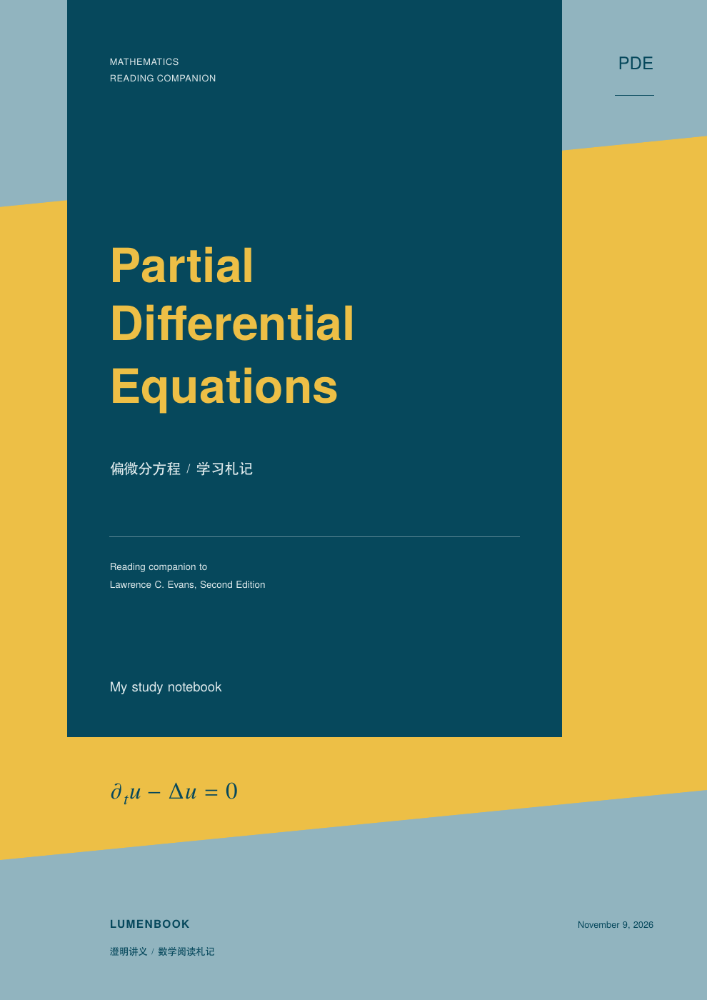
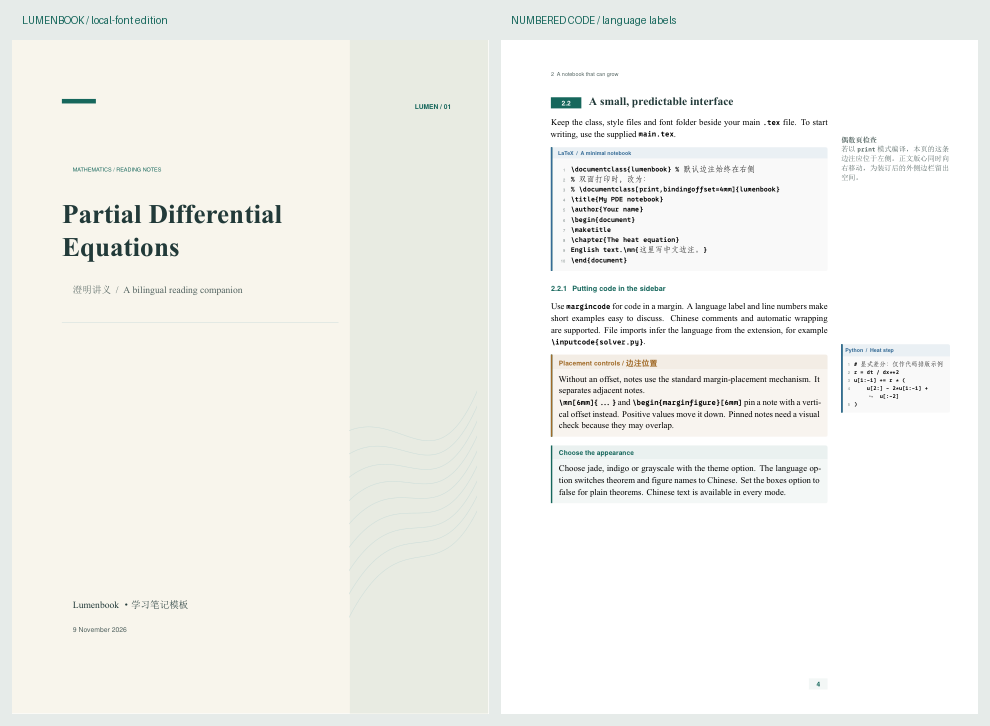

# Lumenbook · 澄明讲义

适合阅读英文数学教材时使用的中英混排边注讲义类。以 [`references/subook/subook.cls`](references/subook/subook.cls) 为主要设计依据，参考 [`references/kaobook-master/`](references/kaobook-master/) 的浅底色环境与配置拆分方式，重新实现为独立的 `lumenbook.cls` 和八个样式包。

“Lumen” 有光与明晰之意：正文保留推理主线，边栏照亮术语、直觉和疑问。默认青玉配色，白色纸面，温和的背景色与细竖线区分数学内容。

新增 **PDE 封面**：参考 Evans《Partial Differential Equations》AMS 第二版封面的蓝黄几何构图，使用独立绘制的矢量色块、中英文字排版和学习札记标识。精修版加大主标题、收紧行距，使用深海蓝与柔和金黄，通过细分隔线整理参考书说明和署名，并以热方程作为底部数学标识。`main.tex` 已启用；其他文档仍可使用原来的暖纸色封面。



- [独立封面 PDF](output/pdf/lumenbook-pde-cover.pdf)
- [带新封面的讲义入口 PDF](output/pdf/lumenbook-pde-notes.pdf)
- [独立封面源码](examples/pde-cover.tex)

```tex
\documentclass[cover=pde]{lumenbook}
\title{Partial Differential Equations} % PDF 元数据保留完整标题
\covertitle{Partial\\Differential\\Equations} % 单独控制封面换行
\notebookseries{MATHEMATICS\\READING COMPANION}
\subtitle{偏微分方程\enspace /\enspace 学习札记}
\coverreference{Reading companion to\\Lawrence C. Evans, Second Edition}
\covermark{PDE}
\coverequation{\partial_t u-\Delta u=0} % 数学模式内容，留空则隐藏
\author{My study notebook}
\date{\today}
```

用 `cover=editorial`（默认）切回原封面。新封面使用独立的深蓝、金黄、蓝灰配色；`theme=mono` 会同步切换封面为灰度。`\covertitle`、`\coverreference`、`\covermark`、`\coverequation` 只影响 PDE 封面。底部默认展示热方程；可用 `\coverequation{-\Delta u=f}` 换为 Poisson 方程，或用 `\coverequation{}` 隐藏。固定版面按 A4、三行英文标题、简短副标题与两行参考说明设计；更长的文字应调整封面字号或坐标，并检查渲染结果。原书仅作视觉参考，封面中的作者栏用于填写札记作者，参考书作者另列在说明中。

独立封面可用 `latexmk -xelatex examples/pde-cover.tex` 编译，生成 `build/pde-cover.pdf`。新模块 `lumen-cover.sty` 与其他类／样式文件一起复制，打包脚本已包含它。

当前版本 **v1.3**，已在 TeX Live 2026 的 XeLaTeX 与 LuaLaTeX 下完成 32 组构建检查。支持本地字体、中英文边注、边栏图表、带行号与语言标签的代码、文字荧光标记，以及可切换的提示／解答版式。详细检查记录见 [VALIDATION.md](VALIDATION.md)。



## 先看效果

- [屏幕阅读示例](output/pdf/lumenbook-screen.pdf)：所有页面的边注都在右侧。
- [双面打印示例](output/pdf/lumenbook-print.pdf)：偶数页边注在左侧，奇数页在右侧，正文版心同步镜像。
- [直接开写的入口](main.tex)：只保留必要内容。
- [完整示例源码](examples/demo-content.tex)：中文、边栏图、缩放表格、代码、交叉引用及整页宽布局。
- [文字标记示例](output/pdf/lumenbook-annotations.pdf)：下划线、波浪线、删除线、五色荧光底色、标注边注与整段背景。
- [学习工具示例](output/pdf/lumenbook-study-tools.pdf)：学习目标、自动引用、可隐藏提示／解答、章节小结、复习清单和手动进度条。
- [独立模板压缩包](dist/lumenbook-starter.zip)：包含新类、样式、说明、示例及 PDF 预览，可解压到新目录使用。

屏幕版与打印版各 8 页，使用同一份正文；文字标记示例 2 页，学习工具示例 3 页。字体、示例源码、正式预览和两个参考项目快照均随仓库提供。

## 仓库结构与参考项目

```text
lumenbook/
├── lumenbook.cls           # 主类文件
├── lumen-*.sty             # 八个独立配置模块
├── main.tex                # 直接开写的入口
├── fonts/                  # 本地字体与字体角色说明
├── examples/               # 完整内容、文字标记、学习工具示例
├── references/
│   ├── README.md           # 参考项目来源和许可说明
│   ├── subook/             # 主要设计依据的原始快照
│   └── kaobook-master/     # 次要设计参考的原始快照
├── output/pdf/             # 正式 PDF 与 PNG 预览
├── dist/                   # 可下载的独立模板压缩包
├── scripts/                # 构建、PDF 检查、打包工具
├── tests/                  # 功能及兼容性检查用例
├── SOURCES.md              # 设计来源、实现边界和许可归属
└── VALIDATION.md           # 本地验证记录
```

两个参考项目作为普通目录快照一并上传，保留源码、示例、图片、文档 PDF 与各自的许可文件。其原始文件内容未修改，编译中间文件由 `.gitignore` 排除。项目来源与版本信息见 [references/README.md](references/README.md)。Lumenbook 独立编译；参考目录用于查阅设计来源。

## 编译与开始使用

推荐 **XeLaTeX**，也支持 LuaLaTeX；输入文件保存为 UTF-8。不支持 pdfLaTeX。需要包含中文、Unicode 数学与 tcolorbox 等宏包的 TeX Live / MiKTeX 安装。当前实际验证环境见 [VALIDATION.md](VALIDATION.md)。

首次下载后，在项目根目录执行：

```powershell
git clone https://github.com/faguomarry-ux/lumenbook.git
cd lumenbook
latexmk -xelatex main.tex
```

已下载项目时直接运行：

```powershell
latexmk -xelatex main.tex
```

输出在 `build/main.pdf`。本目录的 `latexmkrc` 会设置输出目录和编译选项。没有 latexmk 时，可重复执行以下命令，直到交叉引用稳定：

```powershell
xelatex -no-shell-escape -interaction=nonstopmode main.tex
```

在新文件夹使用时，复制 `lumenbook.cls`、八个 `lumen-*.sty`、`fonts/` 和 `main.tex`。没有本地字体目录时会使用 TeX 字体作为后备。使用 VS Code / TeXstudio / Overleaf 时将编译器设为 XeLaTeX，首次至少编译两轮。

批量构建与检查：

```powershell
pwsh -File scripts/build.ps1 -Check
pwsh -File scripts/build.ps1 -Engine lualatex -Check
```

第一条还会更新 `output/pdf/` 下的四份正式 PDF；LuaLaTeX 输出保存在 `build/lua/`。PDF 坐标与内容检查可运行 `python scripts/inspect-pdfs.py`，需要 PyMuPDF 和 Pillow，编译讲义本身不依赖 Python。

重新打包可执行 `pwsh -File scripts/package.ps1`。独立模板包包含类、样式、字体、说明与示例，参考项目保留在 Git 仓库中供查阅。`.gitignore` 保留正式预览、字体、参考源码和指定模板包，排除 `build/`、`tmp/`、其他临时产物及编辑器文件。

## 最重要的开关：边注放在哪一侧

```tex
\documentclass{lumenbook}                    % 默认：始终在右侧
\documentclass[margin=right]{lumenbook}      % 同上，屏幕阅读
\documentclass[margin=outer]{lumenbook}      % 外侧边栏，双面打印
\documentclass[print,bindingoffset=4mm]{lumenbook} % 外侧边栏并留装订余量
```

这些写法是**互相替代**的，选其中一行。`print` 等价于 `margin=outer`，`screen` 等价于 `margin=right`；也兼容 `twoside` / `oneside` 作为别名。不要同时写互相矛盾的选项，若写了，以最后一个设置为准。

默认模式使用 `book` 的单面布局；打印模式使用双面布局，不只是把边注文字搬到左边。基于页码的奇偶判定，偶数页是左页，奇数页是右页。PDF 查看器的“双页视图”应启用“封面单独显示”；实际打印选双面、长边翻转、100% 比例。

默认 A4：上/下边距 24 mm，正文左边距 22 mm、右侧预留 66 mm，边栏宽 48 mm，正文与边栏间距 6 mm。打印时镜像这组尺寸；`bindingoffset` 额外增加装订侧余量，并相应缩小正文宽度，默认 `0mm`，预览使用 `4mm`。大量英文正文若需要更大的字号，可以选择 `12pt`。

可以在导言区用 `\geometry{...}` 调整尺寸。边栏必须满足：外侧预留量至少容得下 `marginparsep + marginparwidth`。当前默认数值针对 A4 优化；其他纸型需要自行调整这一组尺寸。

## 中文、字体与语言

中文默认一直可用，不需要再加载 `ctex` 或 `xeCJK`。

默认 **`fonts=local,fontpath=fonts/,fontset=auto`**，优先直接读取 `fonts/` 中的文件，不需要先安装字体。

| 用途 | 首选 | 后备或说明 |
| --- | --- | --- |
| 西文正文、大标题 | `times.ttf` / `timesbd.ttf` / `timesi.ttf` / `timesbi.ttf` | 完整 Times New Roman 四字重；缺少本地字体时使用 TeX Gyre Termes |
| 小标题、标签、页眉 | TeX Gyre Heros | 作为辅助无衬线字体，形成与正文的层级对比 |
| 数学 | TeX Gyre Termes Math | 与 Times 风格协调，通过 `unicode-math` 排版 |
| 西文代码 | `0xProtoNerdFontMono-Bold.ttf` | 当前目录提供的是真实粗体，后备为 Latin Modern Mono |
| 常用中文 | 本地 `simsun.ttc`（若加入），其次已安装的 SimSun | 当前电脑使用系统宋体；其他电脑无宋体时回退 Fandol Song |
| 中文扩展字 | `simsunb.ttf`、`SimsunExtG.ttf` | 分别为 SimSun-ExtB 和 SimSun-ExtG，仅用于相应扩展汉字 |
| 中文标题、代码 | Fandol Hei、Fandol Fang | 搭配真实粗体与清晰的中文代码字形 |

**`simsunb.ttf` 并不是“宋体粗体”**。实际检查表明，它与 `SimsunExtG.ttf` 均不包含 U+4E00–U+9FFF 范围的常用汉字，因此不将它们误设为普通中文正文主字体。两种引擎均配置了扩展汉字补字，并用 `𠀀`（扩展 B）、`𰀀`（扩展 G）验证。

```tex
\documentclass{lumenbook} % 默认优先 fonts/ 中的本地文件
% 或者明确使用 TeX 发行版字体，方便跨机器交换：
% \documentclass[fonts=tex]{lumenbook}
% 自定义本地字体目录，保留末尾斜线：
% \documentclass[fontpath=my-fonts/]{lumenbook}
```

英文教材学习默认保留 `Chapter`、`Definition`、`Theorem` 等英文名称。若希望中文标题与图表名称：

```tex
\documentclass[language=chinese]{lumenbook}
```

需要固定中文字体方案时可选 `fontset=fandol`、`fontset=windows`（要求系统安装相应字体），或 `fontset=none` 后自行设置 `\setCJKmainfont`、`\setCJKsansfont` 和 `\setCJKmonofont`。`fontset` 负责中文，`fonts` 负责是否优先使用本地文件。西文字体也可在导言区用 `\setmainfont` 等命令覆盖。

封面采用暖纸色、右侧几何色带与曲线纹理；章标题使用大衬线字与淡色章号；节号使用色签；页码使用小型色块。正文仍保持白底，数学框的标题与内容分行，阅读框用浅色标题带区分层级。可用 `\notebookseries{YOUR SERIES}` 自定义封面的小型系列标识。

采用 Unicode 数学后，粗体向量可用 `\symbf{v}` 或 `\symbfit{v}`，黑板粗体可用 `\mathbb{R}`。不要再同时加载 `newtxmath`、`newpxmath`、`mathspec` 或 `amssymb` 等传统数学字体包。

## 边注接口

### 普通文字与编号边注

```tex
English text.\mn{这里写中文理解，也可以写 $u_t-\Delta u=0$。}
Another sentence.\sn{\label{sn:idea}这里是带编号的边注。}
See sidenote~\ref{sn:idea}.
```

`\sn` 与 `\sidenote` 等价，编号按章重置，形式为 `1.1`。标签写在边注内容里。普通 `\mn` 不编号。

无可选参数时通过 `\marginpar` 排放，相邻边注会自动避让；空间不足时仍可能被挤到页底或移页，需要检查最终 PDF。

显式指定偏移量时使用非浮动的 `marginnote`：

```tex
Text.\mn[6mm]{向下移动 6 mm。}
Text.\sn[-2mm]{向上移动 2 mm。}
```

这里的偏移量必须是有效的 TeX 长度，例如 `0pt`、`6mm`、`-\baselineskip`；不采用旧示例中 `*-1` 之类的乘数语法。**固定位置边注不会自动避让**。在定理底色框、浮动体内添加边注时使用显式偏移量，并在编译稳定后检查位置。

### 边栏图片

```tex
\begin{marginfigure}
  \includegraphics[width=\linewidth]{figures/your-image.pdf}
  \caption{English caption / 中文解释。}
  \label{fig:your-image}
\end{marginfigure}
```

`\linewidth` 是边栏的局部宽度。支持 PDF、PNG、JPEG 和 TikZ 图；完整示例直接绘制 TikZ 图，所以不用下载任何图片。`marginfigure` 与正文 `figure` 共用编号，使用正常的 `\caption`、`\label`、`\ref`。

需要固定位置可写 `\begin{marginfigure}[4mm]`，其他富边栏环境同理。

### 自动缩小的边栏表格

```tex
\begin{margintable}
  \caption{Notation / 符号表}
  \label{tab:notation}
  \begin{smalltable}
    \begin{tabular}{ll}
      \toprule
      Symbol & Meaning \\
      \midrule
      $\Omega$ & 空间区域 \\
      $u$ & 待求函数 \\
      \bottomrule
    \end{tabular}
  \end{smalltable}
\end{margintable}
```

`smalltable` 只在表格超宽时缩小，不把原本较小的表格强行放大。也可以用 `tabularx` 配合 `\linewidth` 直接换行。缩小后的文字仍需可读，复杂的大表用 `widepage` 更合适。

### 中文代码与外部代码文件

```tex
\begin{margincode}[language=Python,title={Time step}]
# 中文注释，保留缩进并自动换行
dt = 0.01
\end{margincode}
```

正文使用 `codeblock`，外部文件使用 `\inputcode{file.py}` 或 `\margininputcode{file.py}`。外部文件同样保存为 UTF-8。

```tex
\inputcode[title={Energy estimate}]{examples/energy.py} % 自动标记 Python
\margininputcode[5mm][title={Energy}]{examples/energy.py}
```

正文与边栏代码现在都**默认显示左侧行号和顶部语言标签**。每个代码块从 1 开始编号，空行也计入源代码行数；长行自动折行时不增加源代码行号。

```tex
\begin{codeblock}[language=Python,title={Discrete energy},firstnumber=12]
# 从第 12 行开始显示，可用于摘录原始程序
def energy(u, dx):
    return 0.5 * dx * sum(v*v for v in u)
\end{codeblock}
```

| 参数 | 含义 |
| --- | --- |
| `language=Python` | 直接书写时指定语言；省略为 `Text` |
| `title={...}` | 在语言名后追加代码说明 |
| `firstnumber=12` | 自定义起始行号，默认 1 |
| `numbers=none` | 关闭行号，默认 `left` |
| `offset=5mm` | `margincode` 的固定竖直偏移 |

外部文件按后缀识别 Python、LaTeX、JavaScript、TypeScript、C、C++、Shell、PowerShell、JSON、YAML 和 MATLAB；未知后缀显示 `Text`，显式的 `language=...` 可以覆盖识别结果。`\margininputcode` 保留第一个可选参数作为偏移量，第二个可选参数接收上表配置：`\margininputcode[][language=Python]{file.txt}`。

代码采用 `fvextra` 原样排版，支持中文注释与自动折行，无需 Python、Pygments 或 shell escape。语言标签用于说明代码语言，目前不做按语言的语法高亮。原样代码的起止标记必须各占一行；可选参数要紧跟在 `\begin{codeblock}` 或 `\begin{margincode}` 后面。不能把代码环境放在 `\mn{...}`、`\sn{...}` 这样的宏参数里。

如需固定位置的边栏代码，可用 `\begin{margincode}[language=Python,offset=5mm]` 或 `\margininputcode[5mm]{...}`。

### 自由组合的富边栏

```tex
\begin{marginblock}
  \textbf{Key idea / 核心想法}
  \par A short paragraph with Chinese 中文 and mathematics.
\end{marginblock}
```

它以 minipage 装箱，可包含图片、数学、小表格和代码。**单个边栏块不能跨页**，也不能嵌套另一条边注；不要在其中放 `figure` / `table` 浮动体，直接放图表内容即可。边栏中的 tcolorbox 请设置 `breakable=false`。

## 文字画线、标注与彩色背景

`lumen-mark.sty` 已由类文件自动加载，不需要再次加载 ulem、soul 等文字标记包。

| 命令 | 效果 | 默认颜色 |
| --- | --- | --- |
| `\textul{文字}` | 中文、英文下划线，随文字换行 | 青玉色线条 |
| `\textwave{文字}` | 波浪线，适合待确认的条件 | 暖金色线条 |
| `\textstrike{文字}` | 删除线，记录修正 | 灰色线条 |
| `\textaccent{文字}` | 改变文字颜色 | 青玉色文字 |
| `\textmark{文字}` | 荧光底色，随文字换行 | 淡黄色 |
| `\annotate{词语}{说明}` | 给词语画线并连接编号边注 | 青玉色线条 |
| `\mathmark{公式}` | 为局部数学表达式加底色 | 淡蓝色 |

前五个命令均可用第一个可选参数指定 xcolor 颜色或颜色表达式：

```tex
\textul{先看方程的初值和边界条件。}
\textul[LumenBlue]{the boundary values vanish}
\textwave[LumenWarm]{这个条件是否必要？}
\textstrike{以前的错误理解}
\textaccent[LumenBlue]{weak solution / 弱解}
\textmark{黄色标记的重点结论}
\textmark[LumenMarkGreen]{已经理解的内容}
\textmark[orange!20]{自定义的浅橙色标记}
```

预置的背景色为 `LumenMarkYellow`、`LumenMarkGreen`、`LumenMarkBlue`、`LumenMarkRose`、`LumenMarkViolet`。`theme=mono` 会把这五种预置色转换为不同深浅的灰度；直接指定的自定义颜色仍按其定义显示。

下划线、删除线和波浪线的颜色只影响线条；原文字颜色保持原样。原生 `\emph` 仍然表示斜体强调。

带编号边注的词语标注：

```tex
The \annotate{weak solution}{弱解通过积分恒等式定义。} belongs to a function space.
% 在正文底色框中，显式使用固定偏移量：
\annotate[LumenBlue][3mm]{regularity}{这里补充正则性条件。}
```

`annotate` 的第一个可选参数为线条颜色，第二个为边注偏移量。没有偏移量时使用可避让的普通边注，指定偏移后使用固定位置边注。

整段背景使用 `markblock`，第一个可选参数为背景颜色，第二个为标题；两者都可以省略：

```tex
\begin{markblock}[LumenMarkBlue][概念整理]
这里可以写多段文字、列表和独立公式。
\[
  E'(t)+\mathmark{\|\nabla u(t)\|_{L^2}^2}=0.
\]
\end{markblock}

\begin{markblock}[LumenMarkRose]
没有标题的玫瑰色背景，适合记录待确认的问题。
\end{markblock}
```

`markblock` 可跨页；它与 `readingbox` 等有相同的基本留白。`textmark` 等行内命令用于一个段落内的文字，不能包含空行、代码原样环境或独立公式。整段内容用 `markblock`，公式用 `mathmark`；`mathmark` 会保留公式所在的数学字号，但单个标记公式不自动折行。不要将整条长公式塞进一个行内标记。

标题中可以使用 `textul`、`textmark`、`textaccent` 等命令，PDF 书签保留纯文字。词语标注 `annotate` 用在正文中。边栏内也可以使用文字画线与荧光标记，过长的英文单词仍需提供合理的断词位置。

## 数学与底色环境

提供 `definition`、`theorem`、`lemma`、`proposition`、`corollary`、`assumption`、`example`、`exercise`、`remark`、无编号的 `remark*` 及标准 `proof`。有编号的数学环境共用一条按章递增的序列，避免多个不同的“1.1”难以引用。

```tex
\begin{theorem}[Energy estimate]\label{thm:energy}
  The statement goes here.
\end{theorem}
\begin{proof}
  Your proof. % 保留 amsthm 的自动证毕符号与 \qedhere
\end{proof}
```

保留 `subook` 中依内容区分配色的思路，采用类似 kaobook 的浅底色、低干扰边框：定义青玉、定理暖金、引理紫灰、例子淡蓝、练习浅灰。正文数学框可以跨页；证明沿用 `amsthm` 的语义。

另外提供：

```tex
\begin{readingbox}{Reading strategy / 阅读策略}
  A titled background panel.
\end{readingbox}
\begin{translationbox}
  对英文叙述的中文理解。
\end{translationbox}
\begin{notebox}{Question / 待确认}
  A question or warning to revisit.
\end{notebox}
```

这些环境的可选参数接收 tcolorbox 配置，例如 `\begin{readingbox}[colback=white]{Title}`。`translationbox` 的可选参数同样是配置，不是标题。

主题选择：`theme=jade`（默认）、`theme=indigo`（靛蓝）、`theme=mono`（灰度）。`boxes=false` 只关闭数学环境的底色包装，阅读框和代码框依然存在。

## 学习目标、练习解答与复习工具

`lumen-study.sty` 自动加载，功能按需使用。完整的三页样例见 `examples/study-tools.tex`。

### 自动带类型名称的引用

```tex
\begin{definition}[Energy]\label{def:energy}
  Define the energy of the solution.
\end{definition}

See \cref{def:energy}. % definition 1.1
\Cref{def:energy} is used below. % Definition 1.1
% 多个标签用逗号分隔：
\cref{def:energy,thm:estimate}
```

`cref` 自动添加引用类型名称，`Cref` 用于句首；名称与编号一起成为链接。定义、定理、引理等仍共享连续编号，但保留各自的引用类型。多项引用可以排序和合并，跨章引用按完整章节编号排序。`language=chinese` 时使用中文名称。原有的 `ref`、`eqref`、`pageref` 仍可正常使用，无需另行加载 cleveref。

### 学习目标、小结和易错点

```tex
\readingsource{教材名称、作者与版本}{Chapter 2, pp. 35--42}

\begin{learningobjectives}
  \item 说明方程、初值与边界条件。
  \item 独立重建能量估计的证明。
\end{learningobjectives}

\begin{pitfall}[容易混淆的条件]
  区分振幅的衰减率和能量的衰减率。
\end{pitfall}

\begin{chaptersummary}
  \item 分部积分中的边界项必须说明如何消失。
  \item 估计所需的正则性条件应单独记录。
\end{chaptersummary}

\term{weak solution}{弱解} % 统一排版英文术语与中文对照
```

`learningobjectives` 与 `chaptersummary` 内使用 `item`；可以用第一个可选参数修改标题。`pitfall` 内可以直接写多段正文。这些环境沿用现有主题与底色，并支持跨页。`readingsource` 由作者填写真实来源，模板不会自动补充书目或页码。

### 一份源码生成阅读版与自测版

```tex
\begin{exercise}[First mode]\label{ex:mode}
  求解给定初值下的热方程。
\end{exercise}

\begin{hint}[ex:mode]
  先尝试分离变量。
\end{hint}

\begin{solution}[ex:mode]
  这里写推导、公式或代码块。
\end{solution}
```

`hint` 与 `solution` 的可选参数是所对应习题的标签，省略时使用普通标题。默认同时显示提示和解答。类选项可独立控制：

```tex
\documentclass{lumenbook}                            % 阅读版：全部显示
\documentclass[solutions=false]{lumenbook}           % 只保留提示
\documentclass[hints=false]{lumenbook}               % 只保留解答
\documentclass[solutions=false,hints=false]{lumenbook} % 自测版
```

选其中一行使用。隐藏部分不会排版，也不会执行其中的标签、公式计数和代码内容。题目编号保持一致；隐藏部分内的标签不能从可见正文中引用。解答中支持原有的 `codeblock`、公式和列表。

为便于安全跳过原样代码，提示与解答的起始行、结束行应各占一行，**结束行写在行首，不附加其他文字或注释**。不要在同名环境中再嵌套同名环境。

### 复习清单与手动进度

```tex
\begin{reviewchecklist}
  \checkitem[done]{能完整陈述定理。}
  \checkitem[question]{还不清楚某个正则性条件的作用。}
  \checkitem{需要补做一个边界情形的例子。}
\end{reviewchecklist}

\readingprogress{3}{8} % 在当前位置显示 3/8 的进度条
\marginprogress{3}{8}  % 在边栏显示相同进度条
```

清单状态为 `open`、`done`、`question`，默认 `open`，由作者手动填写。进度参数使用整数，满足 `0 <= 已完成 <= 总数` 且总数大于零。它适合记录页数或习题进度，不会自动推断理解程度，也不会记录到外部服务。边栏版本通过普通边注排放，边栏过密时仍需检查最终位置。

## 整页宽内容与参考文献

```tex
\begin{widepage}
  % 可跨页的宽表、长公式或正文，不放边注
\end{widepage}
```

环境前后主动分页，结束时恢复正文与边栏的布局，避免双面模式下跨到另一页后宽内容伸入装订侧。

参考文献不再写死在类文件里，可以根据英文教材选择 `biblatex` 的格式：

```tex
% 导言区，按需要启用：
\usepackage[backend=biber,style=numeric]{biblatex}
\addbibresource{references.bib}
% 正文中：\cite{key}
% 末尾：\printbibliography
```

图表目录、索引和算法包也按实际内容选择，不为未使用的功能增加编译链。

## 文件分工与来源

| 文件 | 负责内容 |
| --- | --- |
| `lumenbook.cls` | 类选项、中文和字体、页面几何、总装配 |
| `lumen-fonts.sty` | 本地字体优先、四字重映射、中文主字体与扩展字补字 |
| `lumen-style.sty` | 配色、章节标题、页眉页脚、封面、阅读底色框 |
| `lumen-cover.sty` | PDE 蓝黄几何封面、独立标题换行和参考书说明 |
| `lumen-margins.sty` | 文字边注、编号边注、富边栏、表格缩放、整页宽布局 |
| `lumen-math.sty` | 数学环境、统一编号、证明、常用数学符号 |
| `lumen-code.sty` | 中文代码、行号、语言标题栏、边栏代码、文件导入 |
| `lumen-mark.sty` | 中英文字画线、荧光标记、词语标注、整段彩色背景、局部公式底色 |
| `lumen-study.sty` | 自动引用、学习目标、提示与解答开关、小结、复习清单和手动进度 |

这是一套新接口，不承诺原 `subook.tex` 不经修改就能切换。主要保留 `\mn`、`\sn`、`marginfigure`、`margintable` 和常见数学环境的写作习惯；标签采用标准的 `\label`，放在环境内部。

依赖的边注与代码包说明见 [marginnote](https://ctan.org/pkg/marginnote) 和 [fvextra](https://ctan.org/pkg/fvextra)。设计来源、保留与调整的理由见 [SOURCES.md](SOURCES.md)，许可见 [LICENSE](LICENSE)。

## 许可与致谢

Lumenbook 的类文件和样式代码以 **LPPL 1.3c 或更新版本**分发。两个参考项目、字体文件及所加载的 TeX 宏包分别适用各自的许可；本仓库的代码许可不替代第三方许可。感谢 Changxing Su 的 subook，以及 Federico Marotta 等作者的 kaobook。完整来源说明见 [SOURCES.md](SOURCES.md) 和 [references/README.md](references/README.md)。
